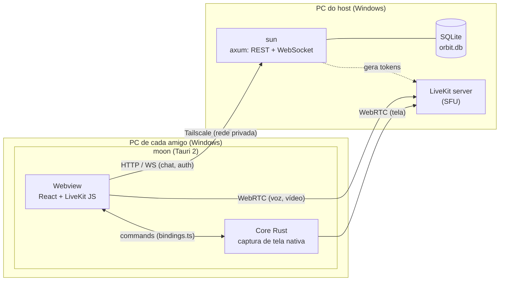

# Arquitetura

O Orbit é um "Discord" self-hosted para um grupo pequeno de amigos (até ~10 pessoas). Ele oferece chat de texto, salas de voz e transmissão de tela.



## Componentes

| Componente | Pasta | Tecnologia | Responsabilidade |
|---|---|---|---|
| **sun** | `sun/` | Rust, axum, tokio, sqlx (SQLite) | Contas (auto-cadastro, ADR 0007), auth (JWT, ADR 0008), canais, mensagens, presença, emissão de tokens LiveKit |
| **moon** | `moon/` | Tauri 2, Vite, React, TypeScript | UI, chat, voz (LiveKit JS no webview), transmissão de tela (Rust nativo) |
| **shared** | `shared/` | Rust, serde, specta | Tipos do protocolo usados por `sun` e `moon` |
| **LiveKit** | (binário externo) | Go | SFU: recebe cada stream uma vez e redistribui |

## Fluxos principais

- **Autenticação:** `moon` faz login via REST e recebe um JWT, que guarda no `localStorage` ([ADR 0010](decisions/0010-token-no-localstorage.md)) e envia como primeira mensagem do `/ws` para o `sun` saber quem é aquela conexão ([ADR 0009](decisions/0009-autenticacao-do-ws-na-primeira-mensagem.md)).
- **Canais:** `moon` lista e cria canais via REST (`/channels`), com o token em `Authorization: Bearer`. Um canal novo é anunciado a todos pelo WebSocket.
- **Chat:** `moon` → WebSocket `/ws` do `sun` → `sun` persiste no SQLite e publica no `hub` (`tokio::sync::broadcast`), que repassa a todas as conexões autenticadas, inclusive a de quem enviou. As mensagens ficam guardadas sem limite de tempo ([ADR 0011](decisions/0011-retencao-de-mensagens.md)).
- **Histórico:** ao abrir um canal, `moon` busca as mensagens anteriores via REST, em páginas (`/channels/{id}/messages`), e as junta por `id` com o que chega pelo WebSocket. Elas ficam em um cache em memória que dura enquanto a tela de chat estiver aberta ([ADR 0012](decisions/0012-tanstack-query-no-front.md) e [0013](decisions/0013-reconexao-automatica.md)).
- **Presença:** o `sun` conta em memória as conexões autenticadas de cada pessoa. Quem entra recebe a lista de contas com o estado de cada uma, e as mudanças são publicadas no `hub`. Um ping periódico derruba as conexões que morreram sem avisar.
- **Reconexão:** `moon` percebe a queda pelo fechamento do socket ou pela falta de resposta ao próprio `ping`, reconecta sozinho sem sair da tela e busca de novo o que está aberto ([ADR 0013](decisions/0013-reconexao-automatica.md)).
- **Voz:** `moon` pede um token ao `sun` (REST) e conecta direto no LiveKit pelo SDK JS no webview, carregado só ao entrar na primeira sala. A voz não depende do WebSocket do chat. O host sobe o LiveKit com os scripts de `scripts/` ([guia](host-setup.md), [ADR 0014](decisions/0014-livekit-no-host.md)), e o core Rust libera o microfone às origens do app ([ADR 0015](decisions/0015-permissao-do-microfone.md)).
- **Transmissão de tela (v1):** dentro de uma sala de voz, `moon` captura com `getDisplayMedia` e publica no LiveKit pelo SDK JS. O vídeo só é baixado por quem clica em **Assistir** ([spec 012](specs/012-transmissao-de-tela.md)).
- **Transmissão de tela (v2, Fase 5):** o core Rust do `moon` captura a janela (Windows Graphics Capture) e o áudio do processo (WASAPI process loopback), e publica no LiveKit como um participante separado (`<usuario>#screen`). Quem assiste recebe pelo webview como qualquer outra track. Ver [ADR 0006](decisions/0006-transmissao-de-tela-hibrida.md).

## Fonte única de tipos

```
shared/src/lib.rs  ──(specta)──►  moon/src/bindings.ts  ◄── front importa daqui
        │
        └──(serde)──► sun  (serializa/desserializa as mesmas structs)
```

`moon/src/bindings.ts` é **gerado**: nunca edite à mão. Ele é regenerado em todo `npm run tauri dev` e em `cargo test -p moon`. A CI falha se estiver desatualizado. Ver [ADR 0005](decisions/0005-tipos-gerados-com-specta.md).

## Rede

O host compartilha o próprio PC com os amigos via **Tailscale**. O `sun` escuta em `0.0.0.0:7700` (configurável com `SUN_ADDR`). O tráfego já vai criptografado pelo WireGuard do Tailscale. Ver [ADR 0003](decisions/0003-rede-via-tailscale.md).

## Limites conhecidos

- O PC do host precisa estar ligado.
- **O upload do host é o gargalo** de voz e vídeo: cada espectador recebe uma cópia de cada stream vinda do LiveKit. Uma tela 1080p60 usa uns 6–8 Mbps por espectador.
- Só Windows (tanto o host quanto os clientes).
